# AdaptiveSonar (MAKARA)

## Low-power, real-time adaptive software-defined sonar transmitter for AUVs

**Team Polaris · Smart India Hackathon 2026 · Problem SIH26058**

MAKARA is a sonar transmitter that changes its ping to suit the water around it. It reads depth, turbidity, temperature and salinity, and from those it chooses the waveform, frequency band, pulse length and amplitude. It then generates the pulse in hardware: on an STM32 with a timer, DMA and DAC, and on a Cyclone V FPGA. The work started as a MATLAB proof of concept (Phase 1), moved onto real hardware (Phase 2), and now includes a custom sensor board (Phase 3).

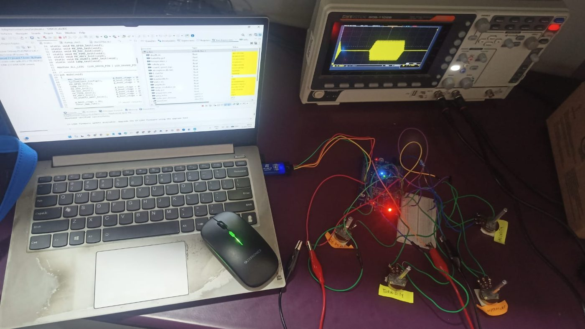

---

## Project Status

| Phase | What | Status |
|---|---|---|
| Phase 1 | MATLAB adaptive sonar POC | ✅ Complete |
| Phase 1B | Performance evaluation | ✅ Complete |
| Phase 1 | Python dashboard | ✅ Complete |
| Phase 2A | STM32F407 firmware: timer + DMA + DAC, adaptive pulses | ✅ Working on the board, checked on an oscilloscope |
| Phase 2B | Cyclone V FPGA (DE1-SoC), real 100–500 kHz band | ✅ Running on the board; simulation verified |
| Phase 2B | FPGA analog output through a DAC0808 | 🔄 In progress |
| Phase 3 | Environmental sensor board (STM32G071, KiCad) | ✅ v1.1 design complete, Gerbers released for fabrication |
| Phase 3 | 3D-printed payload pod | 🔄 CAD done, printing pending |

---

## Repository Layout

| Folder / file | Contents | Details |
|---|---|---|
| `MATLAB/` | Phase 1 environment model, adaptation, waveform generators, analysis | Section 2 |
| `Dashboard/` | Phase 1 Python dashboard | Section 2 |
| `Figures/` | Phase 1 plots | Section 2 |
| `firmware/` | STM32CubeIDE project (STM32F407 Discovery), PC simulator, tools | [firmware/README.md](firmware/README.md) |
| `fpga/` | DE1-SoC Verilog design, testbenches, ROM generator | [fpga/README.md](fpga/README.md) |
| `1_GERBERS_MAKARA_sensor_v1.1.zip` | Fabrication files for the sensor board | Section 5 |
| `docs/images/` | Photos and renders used in this README | — |

---

# 1. Project Objective

Conventional sonar systems often operate using fixed waveform parameters.

This project explores an adaptive approach where the sonar transmission parameters are modified according to the detected underwater environment.

The system takes environmental parameters such as:

- Water depth
- Turbidity
- Temperature
- Salinity

and classifies the environment into different operating conditions.

Based on the classification, the system automatically determines:

- Start frequency
- End frequency
- Pulse duration
- Signal amplitude
- Waveform type

The resulting waveform is then generated and analyzed.

---

# 2. Phase 1: MATLAB Proof of Concept

## 2.1 Architecture

```text
              UNDERWATER ENVIRONMENT
                       |
                       v
              +-------------------+
              | Environment Model |
              +-------------------+
                       |
                       v
              +-------------------+
              | Classification    |
              |                   |
              | Depth             |
              | Turbidity         |
              +-------------------+
                       |
                       v
              +-------------------+
              | Adaptation Engine |
              +-------------------+
                       |
                       v
              +-------------------+
              | Waveform Decision |
              +-------------------+
                       |
              +--------+--------+
              |        |        |
              v        v        v
             LFM     BARKER   GEOMETRIC
              |        |        |
              +--------+--------+
                       |
                       v
              +-------------------+
              | Signal Analysis   |
              +-------------------+
                       |
              +--------+--------+
              |        |        |
              v        v        v
             FFT  Autocorrelation Spectrogram
                       |
                       v
              +-------------------+
              | Python Dashboard  |
              +-------------------+
```

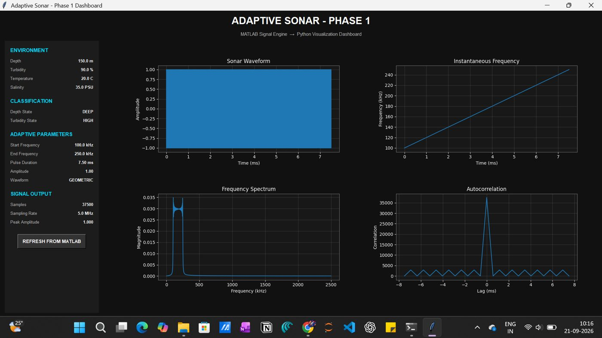

| LFM spectrogram | Window comparison |
|---|---|
|  |  |
| **Barker-13 autocorrelation** | **LFM vs geometric sweep** |
|  |  |

---

# 3. Phase 2A: STM32F407 Firmware

The Phase 1 logic was rewritten in C and runs on an STM32F407G-DISC1.

**Inputs.** Four potentiometers stand in for the depth, turbidity, temperature and salinity sensors. ADC1 reads them through DMA.

**Processing.** The firmware:
1. classifies the water;
2. computes sound speed (Mackenzie) and absorption (Francois–Garrison);
3. picks one of four waveforms: LFM, geometric, hyperbolic or Barker-13;
4. builds the windowed pulse.

**Output.** TIM6 triggers DAC1 on PA4 at 200 kS/s. DMA streams the samples from a ping-pong buffer, so the CPU only wakes to refill a half-buffer and sleeps (`WFI`) between pings.

**Frequency scaling.** All frequencies are scaled by 1/32 at the DAC, so the 100–500 kHz plan appears on PA4 as 3.1–15.6 kHz and can be checked on an ordinary lab scope.

| Decision (examples) | Waveform | Sonar band | Pulse |
|---|---|---|---|
| Shallow, clear water | Barker-13 | 300–500 kHz | 1.9 ms |
| Deep, clear water | Hyperbolic | 300–500 kHz | 3.6 ms |
| Mid depth, mid turbidity | LFM | 200–400 kHz | 5.4 ms |
| Deep, muddy water | Geometric | 100–250 kHz | 9.0 ms |

**Bench result.** In TONE mode the scope shows a Tukey-windowed burst at 5.06 kHz, against a 5 kHz design. The 1 % error is the accuracy of the internal clock. The window fades the pulse in and out with no step at the start or end.

| Windowed burst on PA4 | 5 kHz tone, scope counter 5.06 kHz |
|---|---|
| 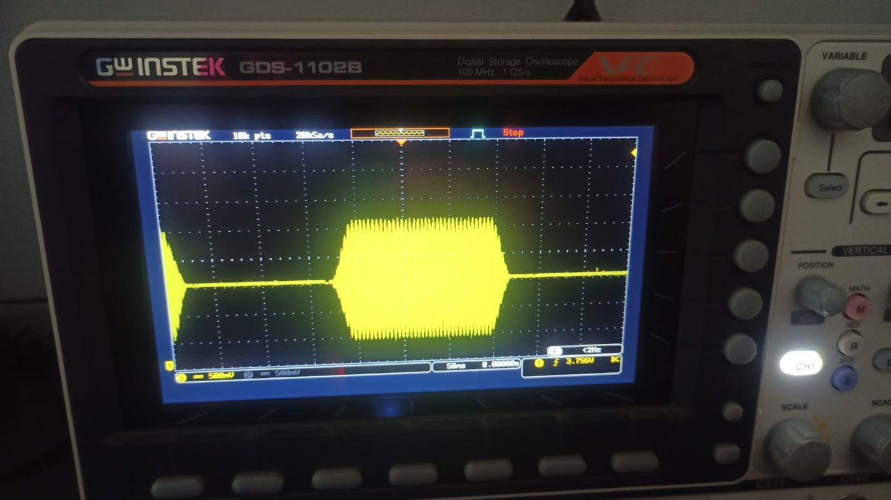 | 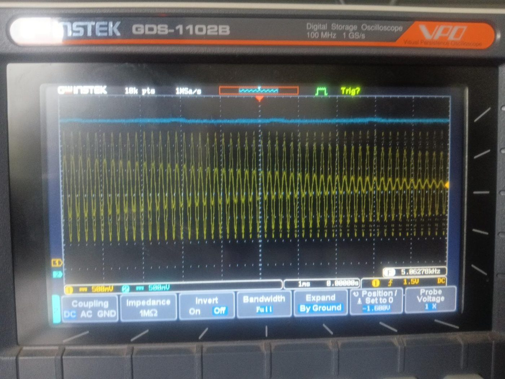 |
| **Window fade-in** | **Window fade-out** |
| 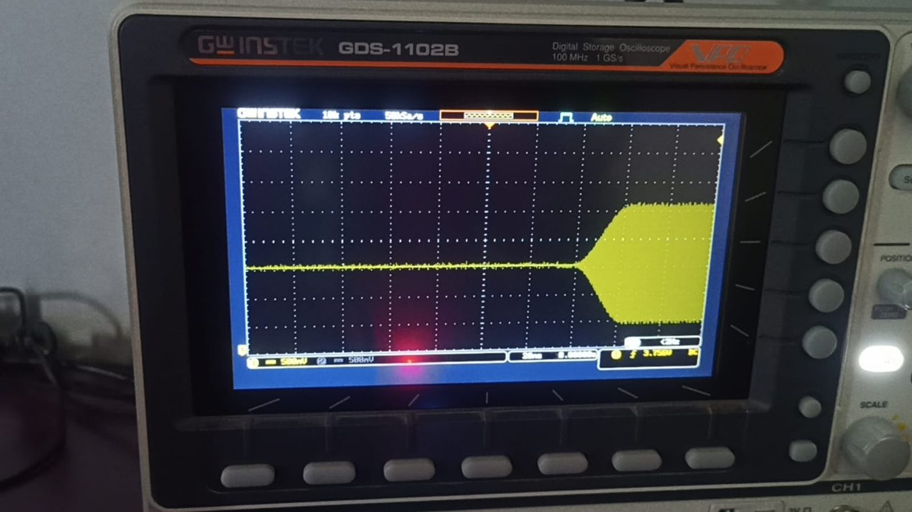 | 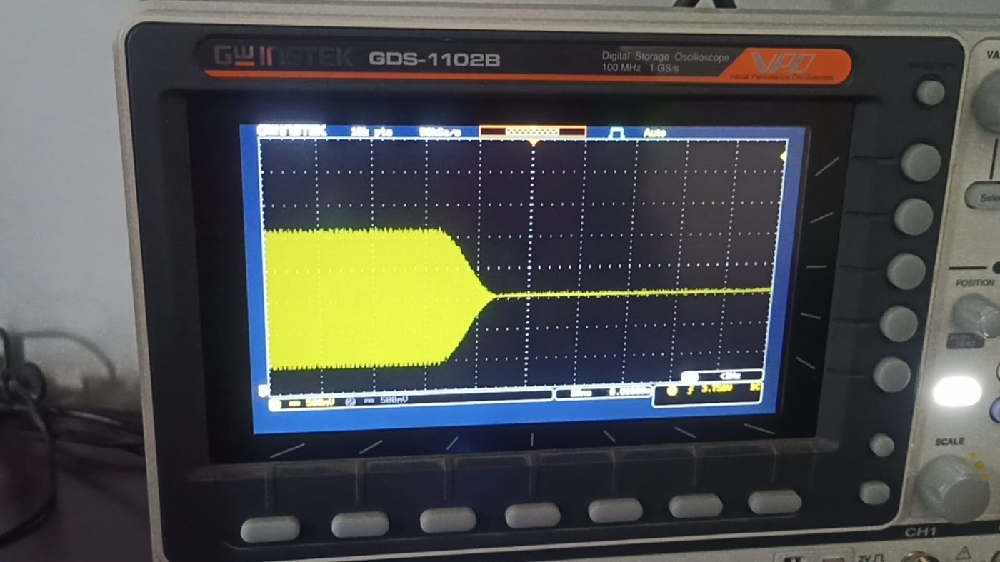 |

Build and flash steps are in [firmware/README.md](firmware/README.md).

---

# 4. Phase 2B: FPGA Transmitter (Cyclone V, DE1-SoC)

The same transmitter was written in Verilog to run at the **real** sonar band, which the STM32's DAC cannot reach.

**Synthesis core.**
- The sample rate is exactly 4 MS/s, derived from the 50 MHz board clock.
- A phase-accumulator DDS draws on ROMs for the sine and for the Hann, Hamming, Blackman and Tukey windows.
- Further ROMs hold sound speed and absorption. They are generated from the same physics models as the C code.

**Board interface.**
- Switches set depth and turbidity.
- The HEX displays show the chosen start and end frequency in kHz.
- The 8-bit output goes to JP1.

| Design running on the DE1-SoC | DAC top bit on the scope (≈ 280–300 kHz carrier) |
|---|---|
| 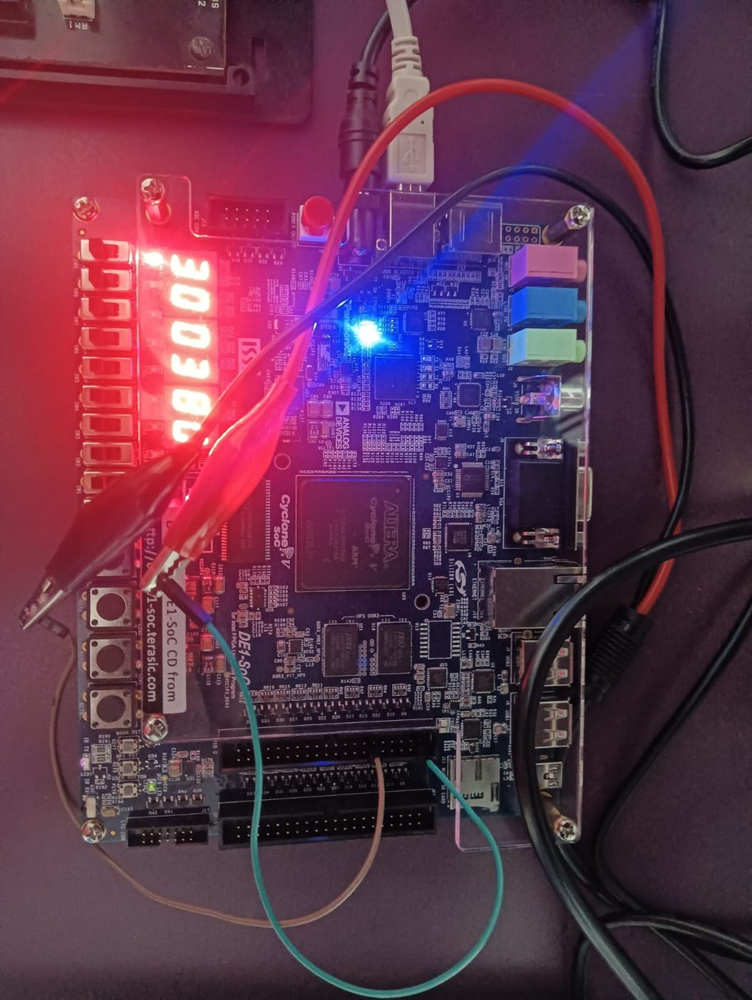 | 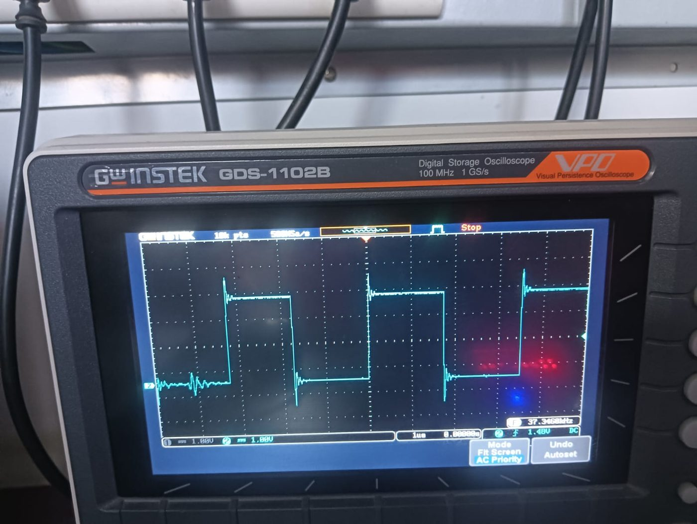 |

**Simulation (Icarus Verilog).** The deep and muddy LFM pulse has a −6 dB band of 208.9–331.1 kHz against a 200–340 kHz target, with a clean windowed envelope.

| LFM, window on | LFM, window off |
|---|---|
| 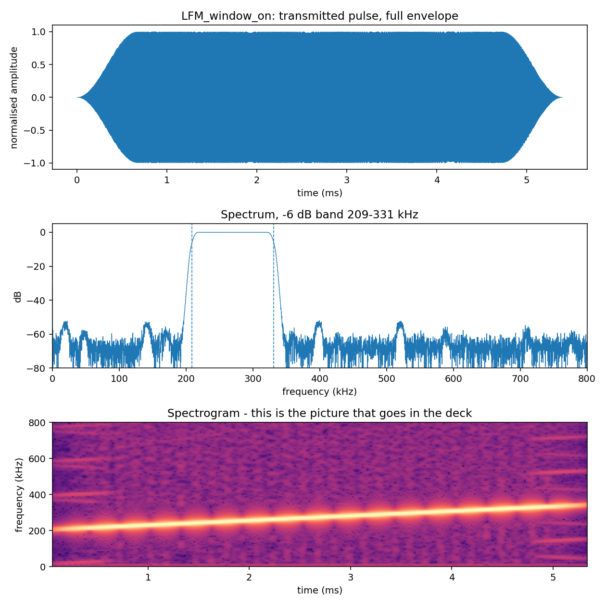 | 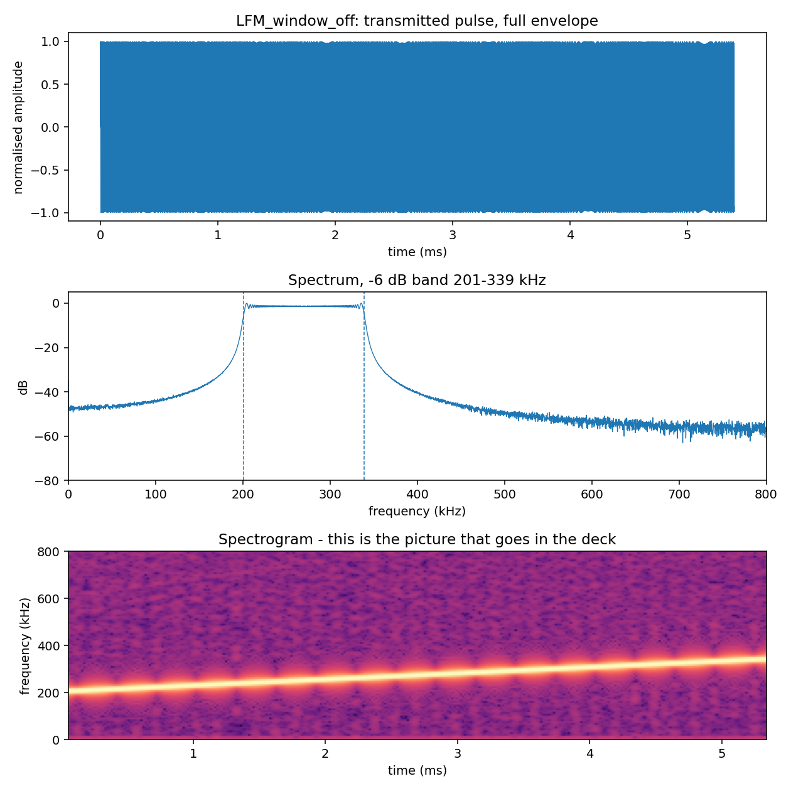 |
| **Geometric** | **Barker-13** |
| 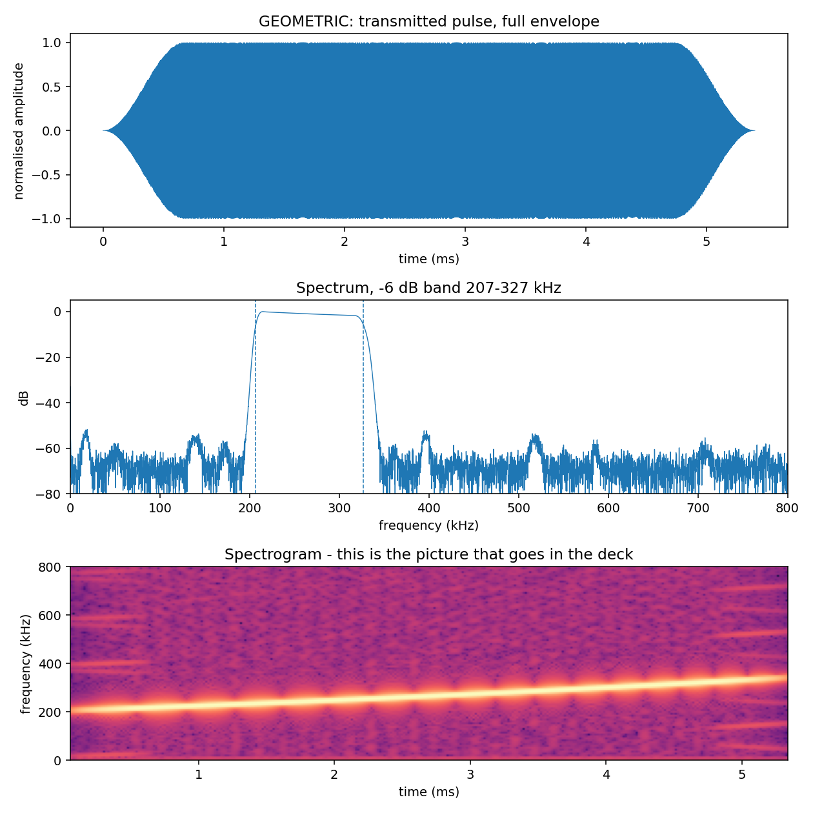 | 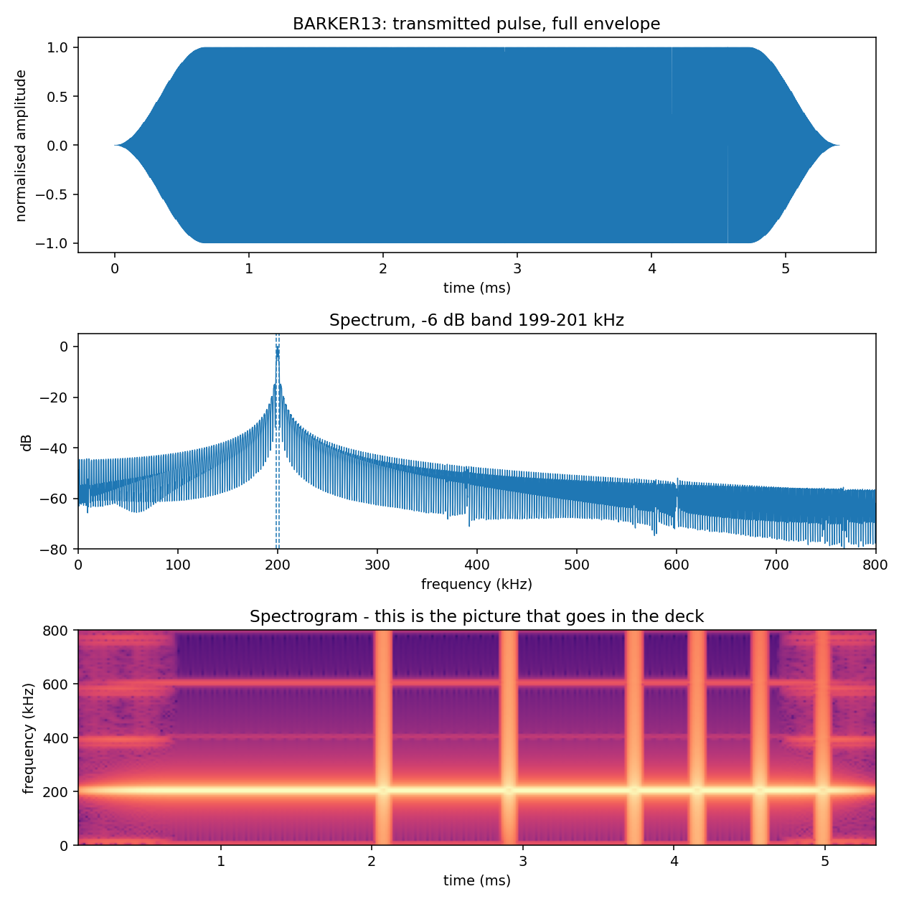 |

Build and simulation steps are in [fpga/README.md](fpga/README.md).

---

# 5. Phase 3: Environmental Sensor Board

This is a two-layer, 80 × 60 mm board built around an **STM32G071KBT6**. It reads the real sensors and will replace the potentiometers.

**Sensors.**
- MS5837-30BA for depth and temperature, over I²C.
- TDS probe and turbidity probe, through ADC inputs with RC filters. The turbidity signal is scaled by a divider and buffered by an MCP6002.
- INA219 for power, over I²C.

**Power.** 5 V input with reverse-polarity protection, regulated down to 3.3 V by an AMS1117.

**Connectors.** Two I²C headers, SWD, UART and a DAC test point.

**Checks.** The v1.1 design passes DRC (0 errors, 0 unconnected) and ERC (0). The fabrication files are in `1_GERBERS_MAKARA_sensor_v1.1.zip`.

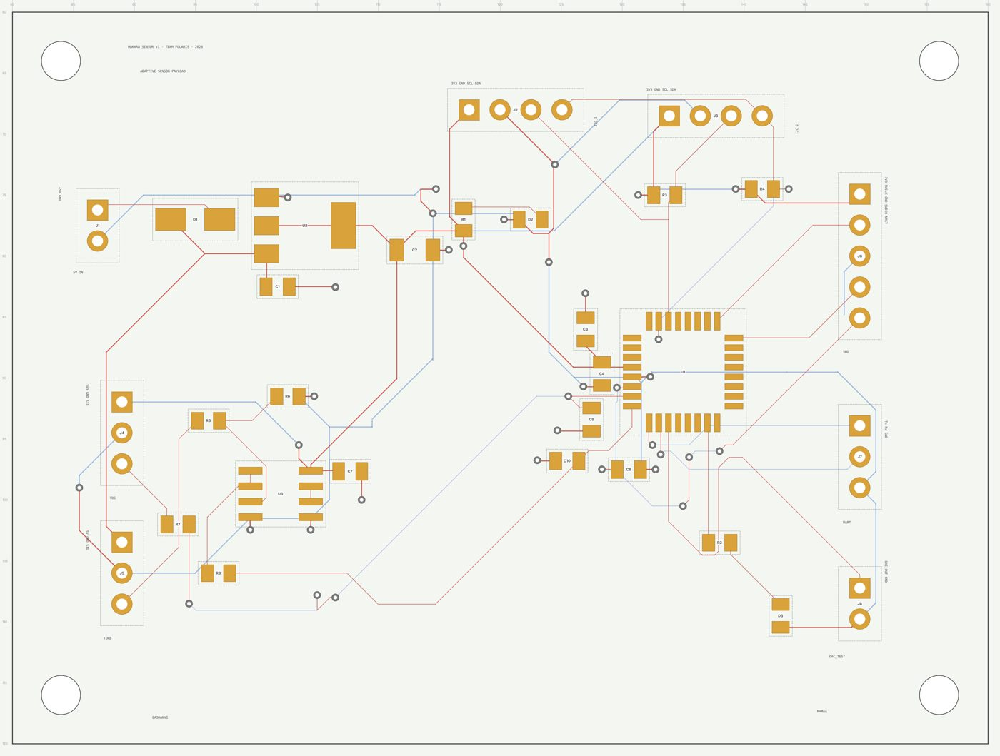

---

# 6. Payload Pod

This is a 3D-printed pressure pod designed to fit an AUV hull slot. It holds the boards on a sled behind a threaded wet cap with O-ring seals, with cable glands for the sensor probes.

| Assembled pod | Exploded view |
|---|---|
| 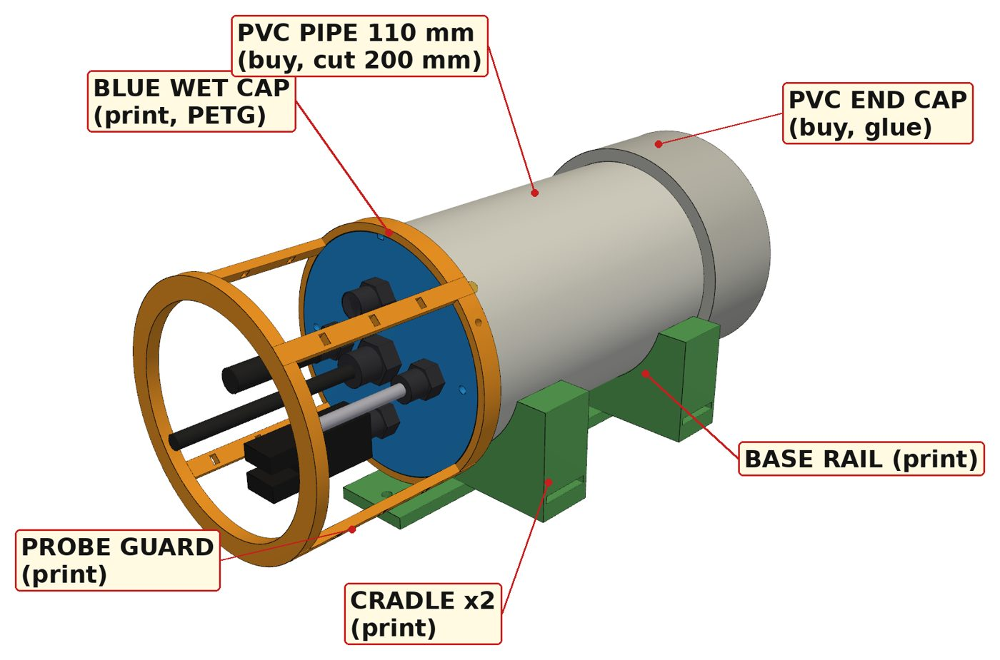 | 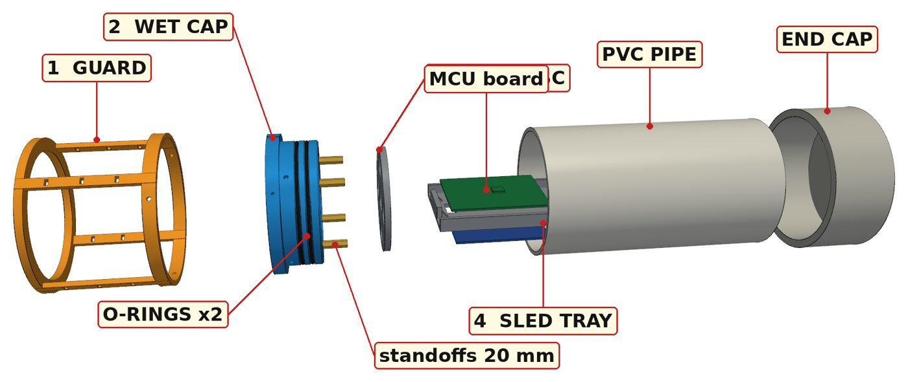 |

---

## Scope of the Claims

MAKARA is an adaptive sonar **transmitter**. It generates and adapts the ping. It does not yet drive a transducer in water, receive echoes or measure range.
